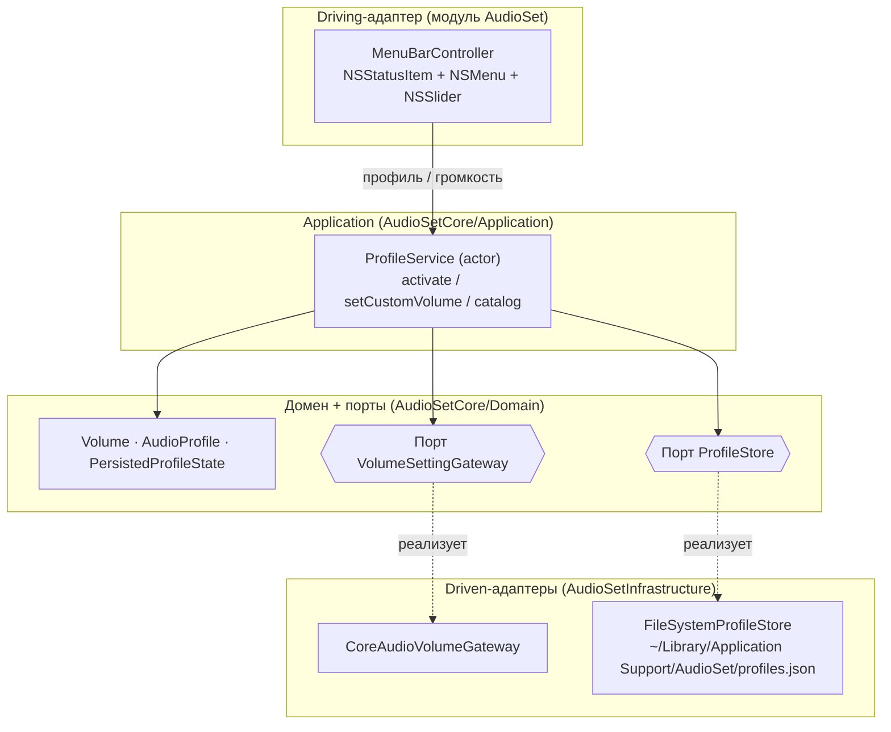

# AudioSet — профили громкости в меню-баре macOS

Приложение-иконка в меню-баре (трее): переключает системную громкость по профилям —
«Кино», «Тихий», «Фокус», «Вечеринка», «Беззвучный», плюс ползунок произвольной
громкости. Архитектура — DDD / hexagonal (ports & adapters).

## Быстрый старт

```bash
swift build        # сборка
swift test         # 13 юнит-тестов ядра и хранилища
swift run AudioSet # запуск: в меню-баре появится иконка динамика
```

Меню: текущая громкость → профили (галочка у активного) → ползунок → «Завершить AudioSet».
Приложение работает в режиме accessory: без иконки в Dock и без главного окна.

## Архитектура



| Кольцо | Модуль | Содержимое |
|---|---|---|
| Домен | `AudioSetCore/Domain` | `Volume`, `AudioProfile`, `PersistedProfileState` и порты `VolumeSettingGateway`, `ProfileStore` |
| Приложение | `AudioSetCore/Application` | `ProfileService` (actor, use cases), `DefaultProfiles`, `ProfileCatalog` |
| Driven-адаптеры | `AudioSetInfrastructure` | `CoreAudioVolumeGateway` (CoreAudio), `FileSystemProfileStore` (JSON) |
| Driving-адаптер + composition root | `AudioSet` | `MenuBarController` (AppKit), `AppDelegate`, `main.swift` |

Зависимости направлены строго внутрь: `AudioSetCore` не импортирует ни AppKit, ни CoreAudio
и покрывается тестами с двойниками портов. Все связи «порт ↔ адаптер» устанавливаются
только в `CompositionRoot`.

### Инварианты

- Громкость применяется к системе **до** сохранения выбора: при ошибке CoreAudio
  активный профиль не меняется ни в памяти, ни на диске.
- `Volume` всегда в диапазоне 0...100 (значения вне диапазона сжимаются).
- Громкость 0 реализуется как mute; любая громкость > 0 снимает mute.
- Отсутствующий или повреждённый `profiles.json` трактуется как пустое состояние —
  дефолтные профили пересоздаются, приложение не падает.
- Новые версии дефолтного набора добавляются миграцией (поле `defaultProfileSetVersion`
  в profiles.json): недостающие профили дописываются в конец, существующие профили,
  их громкости, порядок и выбранный профиль не перезаписываются.
- Перетаскивание ползунка пишет в CoreAudio на каждый тик, но на диск — только
  при отпускании (mouseUp); ручная громкость сбрасывает выбранный профиль.

## Профили по умолчанию

| Профиль | id | Громкость | SF Symbol |
|---|---|---|---|
| Кино | `movie` | 65% | `film` |
| Тихий | `quiet` | 25% | `moon.zzz` |
| Фокус | `focus` | 40% | `brain.head.profile` |
| Вечеринка | `party` | 100% | `party.popper` |
| Беззвучный | `silent` | 0% (mute) | `speaker.slash.fill` |
| Ночной | `night` | 15% | `moon.stars` |
| Музыка | `music` | 80% | `music.quarternote.3` |
| Игры | `games` | 75% | `gamecontroller` |
| Звонки | `calls` | 55% | `phone` |
| Фон | `ambient` | 10% | `waveform` |

## Свои профили

Отредактируйте `~/Library/Application Support/AudioSet/profiles.json` и перезапустите
приложение (id — стабильные строки, порядок сохраняется):

```json
{
  "activeProfileID" : "movie",
  "defaultProfileSetVersion" : 2,
  "profiles" : [
    { "id" : "movie", "name" : "Кино", "symbol" : "film", "volume" : 65 },
    { "id" : "podcast", "name" : "Подкасты", "symbol" : "mic", "volume" : 45 }
  ]
}
```

## Диагностика (CLI)

Проверка проводки CoreAudio без UI:

```bash
.build/debug/AudioSet --print-volume    # печатает текущую громкость (0–100)
.build/debug/AudioSet --reapply-volume  # читает громкость и записывает её же обратно
```

## Технические детали

- Громкость пишется в устройство вывода по умолчанию поканально:
  `kAudioDevicePropertyVolumeScalar` по каналам из `PreferredChannelsForStereo`;
  фолбэк для устройств без поканальной громкости (агрегаты, виртуальные) —
  `VolumeScalar` на мастер-элементе. `kAudioDevicePropertyVirtualMasterVolume`
  из SDK macOS 26 удалён и не используется.
- `ProfileService` — actor: все мутации состояния сериализованы, UI (MainActor)
  общается с ним через `await`.
- Данные пользователя — один JSON-файл с атомарной записью; домен не знает про Codable
  (DTO — деталь адаптера `FileSystemProfileStore`).
